# moxi-ink

Eastern ink dispersing through absorbent paper, in Rust: an implementation of Nelson S.-H. Chu
and Chiew-Lan Tai, [*MoXi: Real-Time Ink Dispersion in Absorbent
Paper*](http://visgraph.cse.ust.hk/MoXi/) (SIGGRAPH 2005), on the CPU or, with the `wgpu` feature,
the GPU.

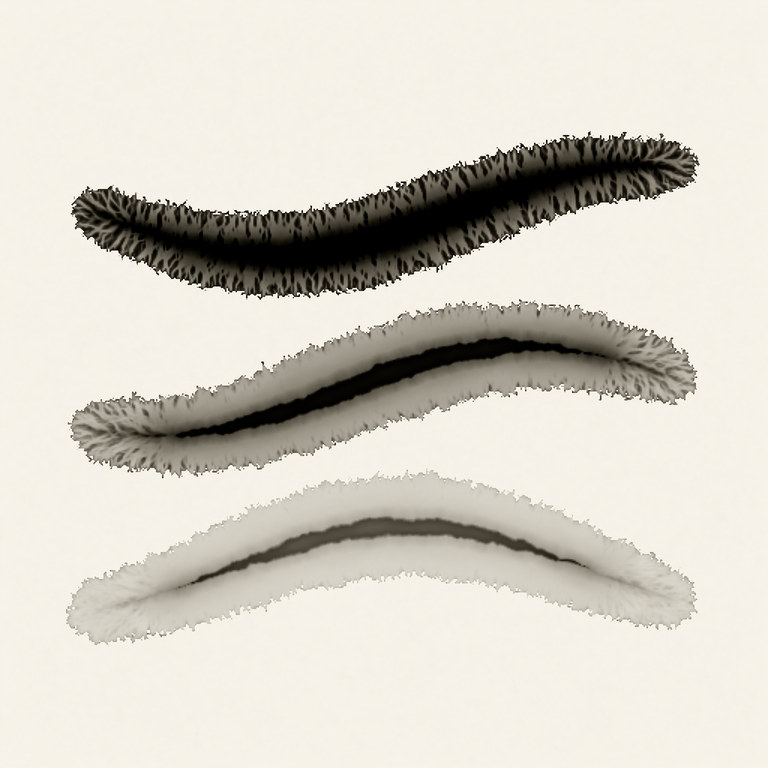

Watercolor flows over the paper's surface; ink on thin Xuan paper soaks *through* the fibres.
MoXi models that water as a lattice-Boltzmann fluid:

- **Permeability.** The paper partly blocks streaming. Fibres conduct water, while alum and glue
  block it.
- **Pinning.** The wet front stays pinned until the water behind it passes a threshold, and the
  paper's disorder varies that threshold.
- **Three layers.** Ink rides the water from a surface reservoir, through the paper, and settles
  into a fixture layer as it dries.

The results are the effects of real ink painting:

- blots with feathery streaks;
- pale fringes where a stroke meets wet paper;
- branching around sizing;
- rough "toes" at the edge of concentrated ink;
- dark rims;
- glue walls that hold ink back.

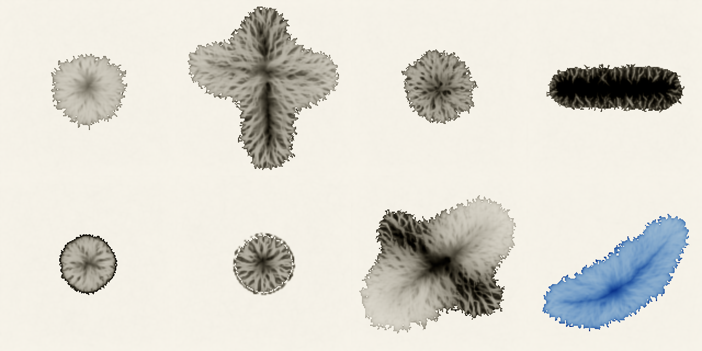

The crate has no engine dependency. It turns brush footprints into ink amounts and colours, so you
can use it offline to bake textures or inside a painting tool. The CPU simulation is
deterministic: the same inputs and seed give the same painting.

## Example

```rust
use moxi_ink::{Ink, Load, Palette, Paper, Params, Trim, footprint, render_trimmed};

let n = 64;
let mut ink = Ink::new(Paper::generate(n, n, 1), Params::default());
// A dab of dilute ink with plenty of water.
ink.deposit(&footprint::disc(n, n, (32.0, 32.0), 8.0, 2.0), Load::ink(5.0, 0.2));
ink.dry(200); // up to 200 steps (drying fully takes a few thousand)
let pixels = render_trimmed(&ink, &Palette::default(), Trim::default()); // 192 × 192 linear RGB
```

- `cargo run --release --features parallel --example effects` paints the scenes above.
- `cargo run --release --features wgpu --example parameters` paints the strips below.
- `cargo run --release --features wgpu,parallel --example gpu` compares the CPU and the GPU and
  paints the strokes above.

## Features

- `parallel`: runs the CPU passes on all cores with rayon. The result is identical to running
  single-threaded.
- `wgpu`: adds `gpu::GpuInk`, the same passes as WGSL compute shaders on any wgpu (29) device.
  - It is about 25× faster than one CPU core on a laptop RTX 3050 Ti. A 512 × 512 sheet runs about
    600 steps a second.
  - Results match the CPU to about 10⁻⁶ over short runs.
  - Over thousands of steps they agree to about 10⁻⁴. The wet front's pinning is a threshold, so
    tiny rounding differences can move it by a site.

## Parameters

Each strip below is the same dab of ink with one setting changed; the middle swatch is the
default. The paper gives values for some constants. The weights of its equations 6 and 9 and the
pigment rates are not published, so their defaults were tuned against its figures; the
documentation of `Params` marks which is which.

### `omega` (ω)

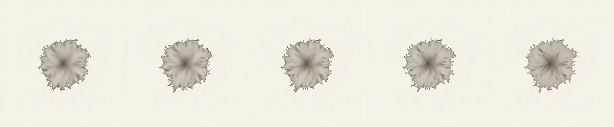

0.2 · 0.35 · **0.5** · 1 · 1.5. This is the lattice-Boltzmann relaxation rate, so lower values
make the water more viscous. Once dry, the marks barely differ: ω changes how the water moves more
than where it ends up.

### `advection` (α)

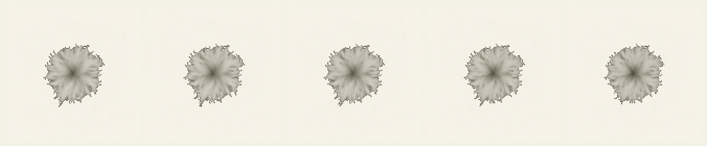

0.05 · 0.15 · **0.3** · 0.5 · 0.8. Below this much water, the advection weakens so that the density
stays positive. The effect on the dried mark is small.

### `evaporation` (εs)

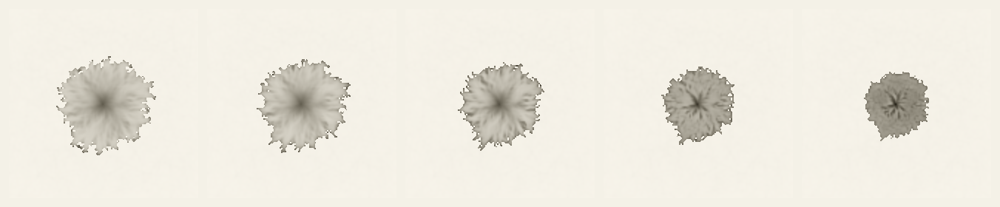

0.00005 · 0.0001 · **0.0002** · 0.0005 · 0.001. Water that dries sooner spreads less.

### `edge_evaporation` (εb)

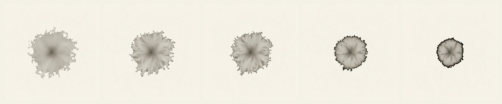

0 · 0.0001 · **0.0002** · 0.001 · 0.003. Water lost at the pinned rim draws ink there and leaves a
dark edge.

### `block_grain` (k₂)

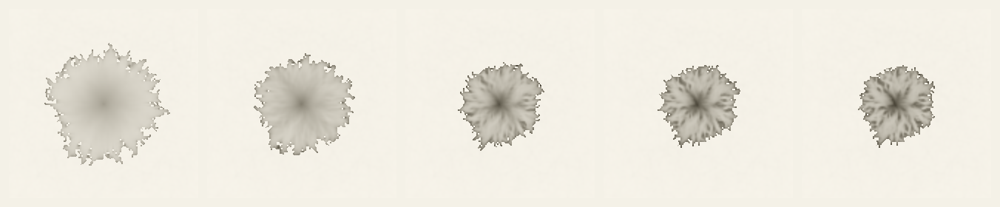

0.2 · 0.5 · **0.85** · 0.95 · 1. This sets how much the gaps between fibres block the water. With
little blocking, a large, smooth blot spreads; with more, the water follows the fibres and
feathers.

### `pin_base` (q₁)

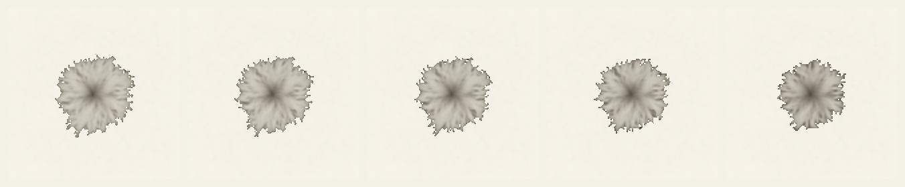

0.03 · 0.06 · **0.1** · 0.15 · 0.25. This is the water a dry site's neighbours need before it can be
wetted. Higher values stop the front sooner.

### `pin_disorder` (q₃)

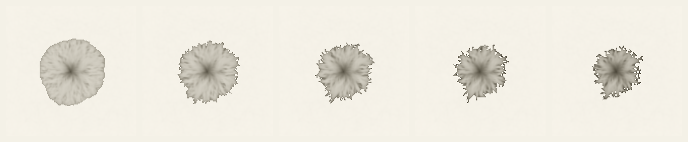

0 · 0.2 · **0.4** · 0.6 · 0.8. This sets how much the paper varies the threshold. At 0 the front
stays round; with more disorder it breaks into toes.

### `hindrance` (γ)

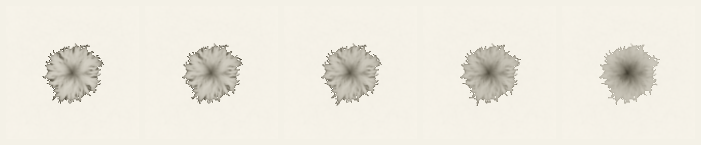

0 · 0.15 · **0.3** · 0.5 · 0.7. This is the share of its ink that fast water leaves behind. More
hindrance keeps the ink nearer the brush.

### `hindrance_still`

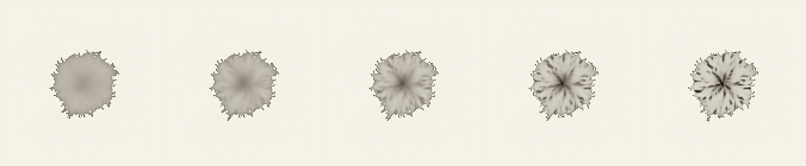

0.5 · 0.7 · **0.85** · 0.95 · 1. This is the share that still water leaves behind. It draws ink into
streaks: at 1 (the paper's value) they become hard, dark flecks.

### Load: glue

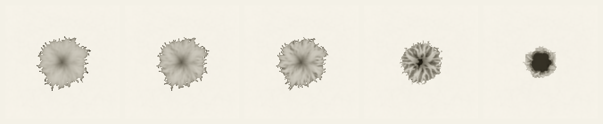

0 · 0.0125 · **0.025** · 0.15 · 0.4. Glue blocks the water, so gluey ink spreads less, fixes sooner,
and grows toes.

### Load: strength

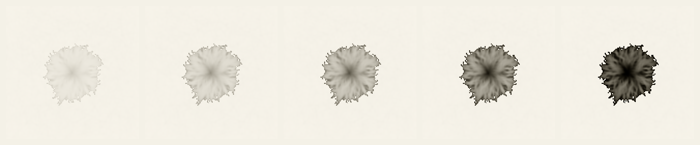

0.05 · 0.12 · **0.25** · 0.5 · 1. This is the pigment concentration in the brush's water.

## How it maps to the paper

| Paper | Here |
|---|---|
| §5.1 three-layer paper model | `Ink`'s surface, flow and fixture fields |
| §5.2 ink deposition, receptivity and seeping | `Ink::deposit`, the `gather_water` pass |
| §5.3.1 permeability (eq. 5, 6) and viscosity | the `block_and_pin`, `collide` and `stream` passes |
| §5.3.2 free boundary, weakened advection (eq. 7, 8) | `collide` |
| §5.3.3 pinning and roughening (eq. 9) | `block_and_pin`, with `Paper`'s grain and pinning textures |
| §5.3.4 evaporation | `gather_water` (εs) and `stream` (εb) |
| §5.4 pigment supply, advection, fixture | `fix_ink`, `move_ink` |
| §6.1 boundary trimming (eq. 11) | `render_trimmed` |
| §6.2 hair textures | not implemented |

Departures from the paper and its authors' code. All but the first two were needed to make the
effects appear and to keep ink conserved:

- Water seeping from the surface, and water evaporating, are added to or removed from the particle
  distributions themselves. The authors' code changed only the derived density, so part of that
  water was lost or regained at the next collision.
- A dry site's pinning threshold uses the glue of its wettest neighbour, since a dry site has none
  of its own.
- Ink moves with the streamed particles at every site. The paper uses this only for newly wet
  sites (its equation 10) and traces the velocity back elsewhere. In this model water spreads
  mostly by streaming rather than by its mean velocity, so tracing left the ink behind. The flux
  scheme also conserves ink exactly.
- Hindrance keeps back a share of the ink in water leaving a site, rather than blending
  concentrations, so it too conserves ink. The share in still water is capped
  (`hindrance_still`), so ink is not trapped where water drains with no net flow.
- Fixing ink scales the flow layer's concentration, as in the paper. Ink carried into water too
  thin to keep is fixed where it lands.
- Boundary trimming keeps stained sites whole, so a dark rim in the outermost ring survives it.

Left out: Chu and Tai's 3D brush dynamics (footprints stand in for them), hair textures, splash
and spray, sucking and pushing ink, and Kubelka–Munk glazing.

## Related

[curtis-watercolor](https://github.com/jfernand/curtis-watercolor) implements Curtis et al.,
*Computer-Generated Watercolor* (SIGGRAPH 1997), the Western-watercolor counterpart MoXi builds on.

## License

Licensed under either of [Apache License, Version 2.0](LICENSE-APACHE) or
[MIT license](LICENSE-MIT) at your option.

Unless you explicitly state otherwise, any contribution intentionally submitted for inclusion in
this crate by you, as defined in the Apache-2.0 license, shall be dual licensed as above, without
any additional terms or conditions.
